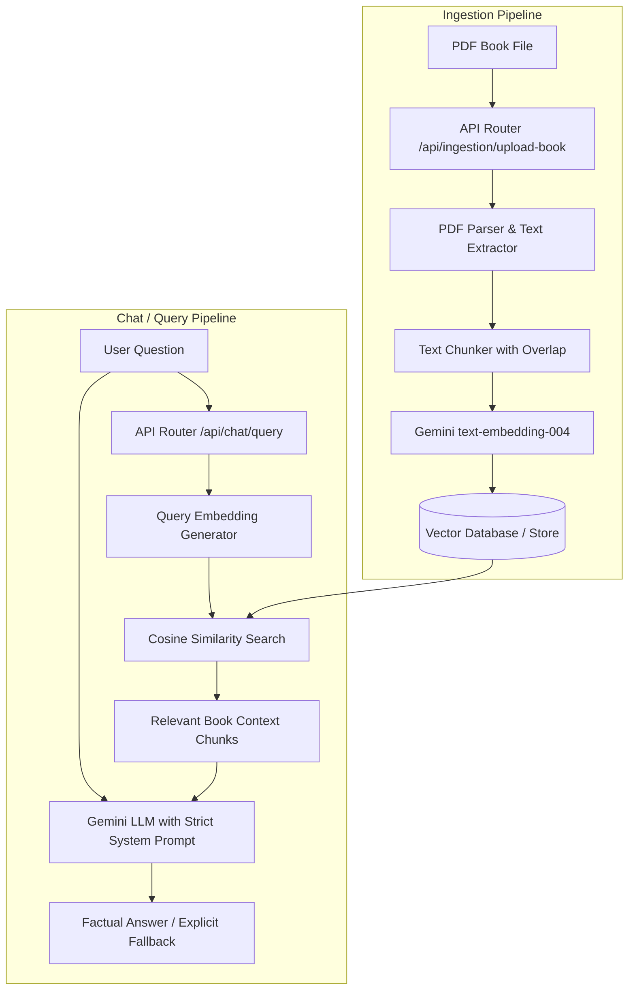

# Private Gemini-Powered RAG Assistant (Backend)

A private AI assistant backend powered by Google Gemini and a vector retrieval pipeline. The application is strictly constrained to your personal book collection—ensuring answers are grounded in your source material without hallucinations or outside training data.

---

## 🏗️ Architecture Overview



---

## 📁 Project Structure

```
.
├── .env.example                # Sample environment variables
├── package.json                # Project dependencies & npm scripts
├── README.md                   # Documentation & developer guide
├── data/                       # Local vector store storage (auto-generated)
├── uploads/                    # Temporary book upload directory (auto-cleaned)
└── src/
    ├── server.js               # Express application entrypoint
    ├── controllers/
    │   ├── ingestionController.js   # PDF upload, chunking, and embedding controller
    │   └── chatController.js        # User question handling and semantic search controller
    ├── models/
    │   └── vectorDbModel.js         # Vector storage layer & cosine similarity search
    ├── routes/
    │   ├── ingestionRoutes.js       # Book ingestion REST endpoints
    │   └── chatRoutes.js            # Chat / RAG query REST endpoints
    ├── services/
    │   ├── embeddingService.js      # Google Gemini embedding service (text-embedding-004)
    │   └── geminiService.js         # Google Gemini LLM generation service with guardrails
    └── utils/
        ├── pdfParser.js             # PDF text extraction utility
        └── textChunker.js           # Text chunking and sliding window utility
```

---

## 🚀 Getting Started

### 1. Installation
```bash
npm install
```

### 2. Environment Configuration
Create a `.env` file from `.env.example`:
```bash
cp .env.example .env
```

### 3. Running the Server
```bash
npm run dev
```

---

## 📡 API Endpoints

- **Upload Book (PDF)**: `POST http://localhost:5000/api/ingestion/upload-book`
- **List Books**: `GET http://localhost:5000/api/ingestion/books`
- **Ask Question**: `POST http://localhost:5000/api/chat/query`
