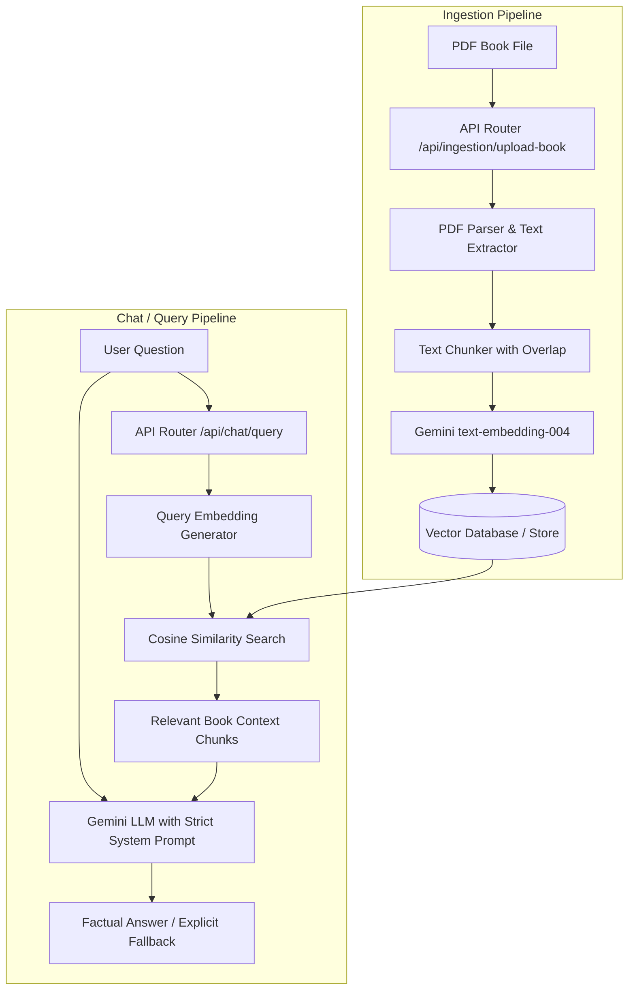

# Private Gemini-Powered RAG Assistant (Backend)

A private AI assistant backend powered by Google Gemini and a vector retrieval pipeline. The application is strictly constrained to your personal book collection—ensuring answers are grounded in your source material without hallucinations or outside training data.

---

## 🏗️ Architecture Overview



---

## 📁 Project Structure

```
.
├── .env.example                # Sample environment variables
├── package.json                # Project dependencies & npm scripts
├── README.md                   # Documentation & developer guide
├── data/                       # Local vector store storage (auto-generated)
├── uploads/                    # Temporary book upload directory (auto-cleaned)
└── src/
    ├── server.js               # Express application entrypoint
    ├── controllers/
    │   ├── ingestionController.js   # PDF upload, chunking, and embedding controller
    │   └── chatController.js        # User question handling and semantic search controller
    ├── models/
    │   └── vectorDbModel.js         # Vector storage layer & cosine similarity search
    ├── routes/
    │   ├── ingestionRoutes.js       # Book ingestion REST endpoints
    │   └── chatRoutes.js            # Chat / RAG query REST endpoints
    ├── services/
    │   ├── embeddingService.js      # Google Gemini embedding service (text-embedding-004)
    │   └── geminiService.js         # Google Gemini LLM generation service with guardrails
    └── utils/
        ├── pdfParser.js             # PDF text extraction utility
        └── textChunker.js           # Text chunking and sliding window utility
```

---

## 🚀 Getting Started

### 1. Installation
```bash
npm install
```

### 2. Environment Configuration
Create a `.env` file from `.env.example`:
```bash
cp .env.example .env
```

### 3. Running the Server
```bash
npm run dev
```

---

## 📡 API Endpoints

- **Upload Book (PDF)**: `POST http://localhost:5000/api/ingestion/upload-book`
- **List Books**: `GET http://localhost:5000/api/ingestion/books`
- **Ask Question**: `POST http://localhost:5000/api/chat/query`

## Operations notes (admin system)

- Requires Node 22.5+ (uses node:sqlite).
- Persist DATA_DIR (database, vault, uploads) on a durable volume; otherwise accounts and records vanish on redeploy.
- Gemini API keys are managed from **Admin > System Settings** (Primary, Fallback 1, Fallback 2). They are stored AES-256-GCM encrypted in the `system_settings` table, never returned to the browser, and take effect immediately without a restart. Order used: DB primary -> DB fallback 1 -> DB fallback 2 -> `GEMINI_API_KEY` from the environment. Calls rotate to the next key on rate limits (429) or rejected keys (invalid / leaked / permission denied).
- The encryption master key is `SETTINGS_ENCRYPTION_KEY` (optional) or `$DATA_DIR/.settings.key`, generated on first use. Back it up with the data volume: without it, stored keys cannot be decrypted and must be re-entered.
- Without any usable key, uploads that need OCR or embeddings fail with AI_NOT_CONFIGURED / AI_KEY_INVALID (shown in the UI, never as fake success).
- **Admin > System > End-to-end self-test** uploads a temporary document, processes it with the live key, checks the admin statistics, asks the public chat about it and deletes it. Each run is recorded in the activity log.
- Dashboards refresh in real time through `GET /api/events` (Server-Sent Events). Nginx must not buffer this location; the configs in `deploy/nginx/` already set this up.
- waraqa and bahth are installable PWAs (`manifest.webmanifest`, `service-worker.js`, `icons/`). The service workers never cache `/api/*`. Bump `version` in each `service-worker.js` on a release to drop old caches.
- First start creates the admin account from ADMIN_EMAIL / ADMIN_INITIAL_PASSWORD / ADMIN_NAME.
- Supervisors are invited from the admin panel (one-time activation link, 72 h).
- Run npm test for acceptance tests; node scripts/check-i18n.js for the localization audit; node scripts/verify-deployment.js against deployed URLs; `docker exec masruq_rag_backend node scripts/ai-diagnose.js` for a live AI check.
- Existing records can be repaired from Admin > System > Reconciliation (analyze first, then apply).
